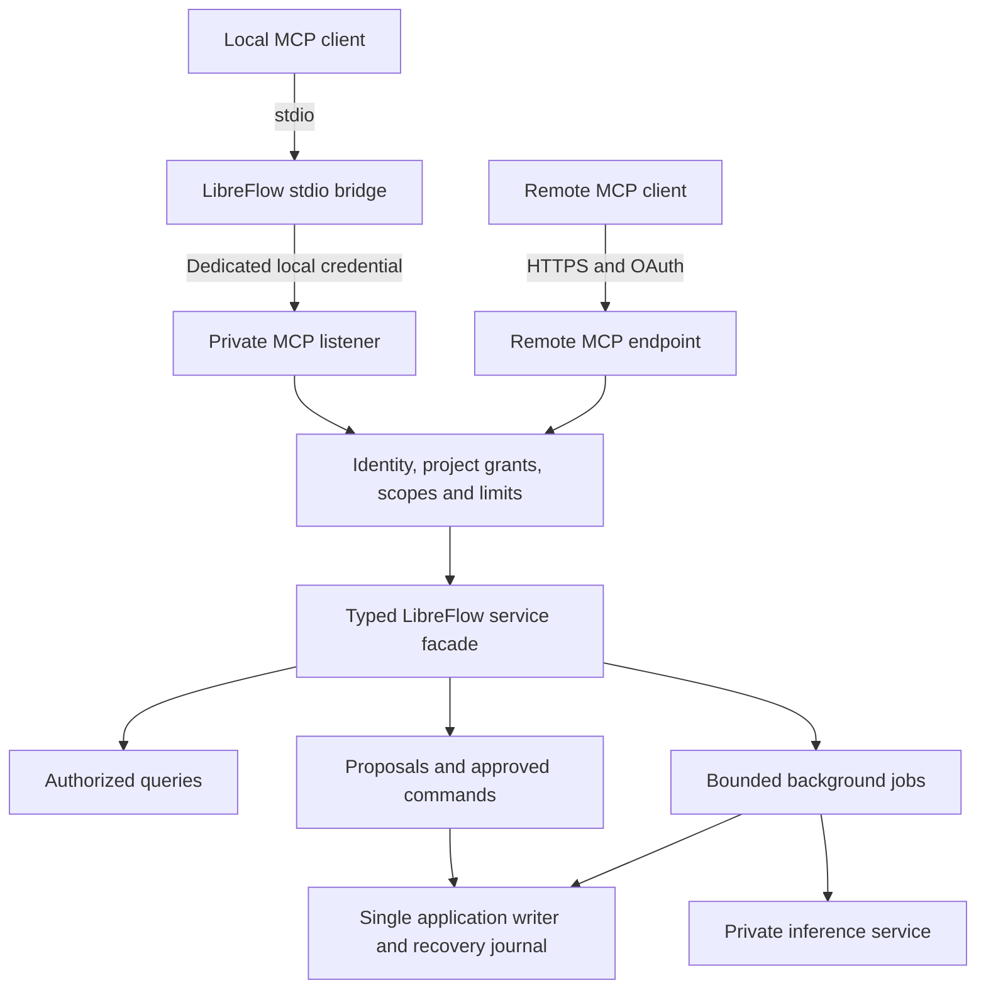

> Implementation status: the local read-only release is described in [Local AI connections](mcp-local-setup.md). It covers scoped project/annotation reads, previews, models/classes, version/health summaries, permission management, and a stdio bridge. Write actions, dataset jobs, and remote OAuth below remain planned.

# Secure MCP access for LibreFlow

Status: phased roadmap; the local read-only release is implemented. Later phases remain proposed.
Reviewed: 2026-11-14.
Code baseline: c6cb37846f54a0518430a9298c4930a5aeeaa0ea.
Branch: `plan-secure-mcp-access`.
Evidence: [protocol and security research](mcp-protocol-research.md).

## Recommended outcome

Let a user connect an MCP-capable assistant, select permitted projects and capabilities, inspect activity, and revoke access. Start with read-only project, annotation, model and version inspection. Add draft inference, approved annotation changes and version/export jobs after write-safety checks pass.

Example: "Detect only Object B in Batch 3, preserving Object A." The assistant discovers the model's class IDs, previews the exact image selection/settings, starts authorized inference into drafts, and presents proposed additions. Applying them checks both permission and unchanged source revisions.

This targets the Express/Docker application on port 6767. The separate static-web/encrypted-workspace runtime needs its own design. A local server does not automatically become reachable by cloud-hosted clients.

## 1. Existing foundations and concrete gaps

Findings are from the deployed code baseline.

| Area | Reuse | Change needed for MCP |
| --- | --- | --- |
| `lib/api-keys.js`, `middleware/automation-auth.js`, `lib/project-access.js` | Hashed keys, expiry/revocation, scopes, membership checks | Empty project allowlists currently mean all accessible projects; session auth takes precedence over bearer auth. Add an MCP-specific principal, explicit grants and independent authentication without cookie elevation. |
| `routes/automation.js` | Project/image reads and persistent jobs | Bound and paginate lists. Existing `projects:read` also permits original image downloads; separate metadata and image-disclosure permissions. |
| `lib/access-control.js`, model routes | Project membership and model sharing rules | Recheck stored image/model/batch/version relationships on every request, including job execution. IDs supplied by a model confer no access. |
| `routes/annotations.js`, `lib/annotation-history.js` | Shape validation, history, restore and review updates | Saves replace the annotation set without expected-revision preconditions. Add proposals, additive apply and revision checks. Revision-list reads can create legacy baselines; MCP reads must be side-effect-free. |
| `lib/job-runner.js`, `lib/inference-client.js` | Resumable inference, confidence, tiling, cancellation | Jobs currently save detections directly. Add draft mode and live grant checks. The inference client accepts `classIds`, but `createInferenceJob` does not retain them; carry selection end to end. |
| `routes/dataset-lifecycle.js`, version libraries | Batch sources, splits, preprocessing, augmentation, previews, immutable snapshots and streamed exports | Version creation remains inside an HTTP request. Queue long work; separate read/create/export/delete permissions. Freeze selection and defaults so preview and creation use identical inputs. |
| `lib/audit-log.js` | User/project events | Record client/connection, grant, request/operation IDs, denied access and sensitive reads with redaction. Whole-file local logs are not tamper-proof. |
| `lib/data-store.js`, `lib/json-store.js` | Current JSON records and assets | Keep one application writer; add multi-file recovery and concurrency controls before MCP writes. PostgreSQL scaffolding is not connected to runtime persistence. |
| `server.js`, security helpers | Session/origin protection, protected files and safe remote fetching | Dedicated MCP auth, limits, Host/Origin policy and error handling; avoid general 50 MB parsing, session fallback and HTML redirects on protocol requests. |

The existing API is a useful foundation, but wrapping every REST endpoint as an MCP tool would expose capabilities beyond the user's intended grant.

## 2. Architecture and transport

Keep authorization and domain operations in the application process. The protocol layer calls a small typed service facade shared with browser/automation routes where behavior overlaps.



### Local first

- Ship a pinned `libreflow-mcp` stdio entry point. stdout is protocol-only; diagnostics go to stderr.
- Read a dedicated credential from an environment variable or OS secret store. Tool arguments cannot supply credentials or change the startup-configured LibreFlow destination.
- Add a private MCP listener, disabled by default. Native installs bind to loopback. Docker publishes its dedicated port only on host 127.0.0.1; container-network access still requires authentication.
- The bridge uses official SDK transport support, preserves the protocol contract/cancellation and never opens data directories or starts a second job runtime.
- Give local credentials a distinct purpose and validation path: they cannot authenticate to broader legacy APIs. They are hashed at rest, scoped, expiring and revocable.
- Keep the private listener out of public proxy routes. Remote-device connections use HTTPS/OAuth mode instead of plaintext LAN credentials.

### Remote access

- Add a separately enabled HTTPS Streamable HTTP endpoint, for example `/mcp`, behind a configured trusted proxy.
- Integrate a maintained OAuth/OIDC authorization server, with tokens specifically issued for LibreFlow MCP. Validate issuer, subject, audience/resource, expiry and scopes.
- Map issuer plus subject to a LibreFlow user through trusted account linking; an email match alone is insufficient.
- Keep project grants and current domain permissions authoritative even when a token is valid.
- Do not forward inbound tokens to inference or other downstream services. Internal calls receive a verified principal.
- Qualify the authorization-server deployment against the conformance suite before shipping remote mode. Local mode does not require an authorization server.
- Cloud clients need an explicitly configured reachable HTTPS gateway or supported private connector. Do not expose the current development server or inference port directly.

### Shared authorization contract

Only verified authentication code creates:

```text
userId, clientId, connectionId, credentialId, grantedScopes,
allowedProjectIds, expiresAt, authorizationVersion
```

Effective access is the intersection of current application permissions, connection project grants, operation scopes and any operation-specific approval. A model-supplied actor, cookie, project ID, session ID or client-info field cannot replace it.

Filter discovery/results and repeat checks during execution. Resolve parent-child relationships from stored records. Use consistent inaccessible/not-found responses when revealing existence would leak private data.

## 3. Permissions and user controls

Add an **AI connections** screen in account/integration settings, with a project entry point. Show client identity, selected projects, data disclosed, allowed actions, expiry, activity, Revoke, and Stop queued work. Keep it usable on mobile and by keyboard.

Defaults:

- Disabled until configured; no selected projects means no access.
- Metadata inspection is the starting permission. Annotation contents and image previews are separate choices.
- Original images, exports, inference and mutations require explicit additional grants.
- Suggested local-key expiry: 30 days, configurable shorter. Remote access tokens should be short-lived.
- A user can pre-authorize bounded safe operations with project/action/work limits. Requests beyond that grant use step-up authorization.
- Explain that returned data is disclosed to the connected client/provider. Revocation cannot retract previously returned data.

Proposed capabilities are separate from legacy automation scopes:

| Capability | Allows |
| --- | --- |
| `mcp:projects:read` | Selected project metadata, labels, batches and counts |
| `mcp:annotations:read` | Geometry, review state and permitted revision history |
| `mcp:images:preview` | Bounded thumbnails/crops |
| `mcp:images:read` | Explicit original image access |
| `mcp:models:read` | Model metadata and validated class IDs, excluding weights |
| `mcp:versions:read` | Bounded manifests, statistics and health reports |
| `mcp:inference:run` | Resource-bounded inference into drafts |
| `mcp:annotations:append` | Approved additions against expected revisions |
| `mcp:versions:create` | Approved immutable version builds |
| `mcp:exports:create` | Requested export formats/options |
| `mcp:jobs:read`, `mcp:jobs:cancel` | Authorized connection-bound job inspection/cancellation |

Composite operations require all relevant scopes. An annotation-bearing export needs annotation read; including original images additionally needs image read. Running a local model does not inherently disclose image bytes to the assistant. Reports must omit sensitive details outside the granted data scopes.

Keep user/collaborator administration, credentials, connectors, model uploads, URL/folder ingestion, annotation replacement, review approval and deletion out of early releases. Future destructive operations need separate grants and operation-specific approval.

Start with project-backed datasets. Standalone datasets need explicit dataset grants plus their current owner/share rules; a missing project association must never mean unrestricted access.

## 4. Tool catalog and output contracts

Proposed tool names:

| Release | Tools | Behavior |
| --- | --- | --- |
| Read MVP | `libreflow_list_projects`, `libreflow_get_project` | Search/pagination; authorized project detail, bounded labels/batches/counts |
| Read MVP | `libreflow_list_images`, `libreflow_get_image_preview` | Batch/status filters; image-ID previews with original dimensions and coordinate transforms |
| Read MVP | `libreflow_get_annotations` | Paginated geometry and current revision, without implicit writes |
| Read MVP | `libreflow_list_models`, `libreflow_get_model_classes` | Authorized model metadata and stable numeric class IDs |
| Read MVP | `libreflow_list_versions`, `libreflow_get_version`, `libreflow_get_dataset_health` | Bounded manifests and summary-first reports |
| Jobs | `libreflow_get_job`, `libreflow_cancel_job` | Grant-bound status, bounded results and cancellation |
| Draft inference | `libreflow_preview_inference`, `libreflow_start_inference` | Frozen image selection, class IDs, confidence, tiling and budgets; draft results |
| Annotation writes | `libreflow_propose_annotations`, `libreflow_apply_annotation_proposal` | Validated native geometry, expected revisions and durable operation IDs |
| Versions | `libreflow_preview_version`, `libreflow_create_version` | Batch source, finished/null selection, split ratios, seed, preprocessing and augmentation; frozen preview then job |
| Exports | `libreflow_export_version` | Version/format/include-images/include-null options; authorized streamed output |

Schemas use explicit types, enums, finite coordinates and limits on strings, arrays, pixels, jobs and numeric ranges. Reject unsupported options; validate at the protocol edge and domain boundary. No generic HTTP, SQL, shell, filesystem-path or arbitrary-Python tools.

Return structured results plus short readable summaries: IDs, revisions, normalized settings, counts, warnings, cursors and authorized app links. Use version-correct SDK errors: malformed protocol/unknown tool versus actionable tool execution failures.

Suggested domain pagination: default 50 records, maximum 100 and a configurable text budget such as 256 KiB, with explicit continuation. Bind cursors to principal/filter/resource; they grant no authority. These are product defaults, not MCP requirements. Protocol catalog pagination follows MCP's separate cursor contract.

Optional read-only resources can reuse queries, for example `libreflow://projects/{id}/summary`. Validate URI structure; never interpret it as a file path. User-invoked prompts such as "inspect dataset health" can follow later. Prompts and returned data cannot confer permissions. Sampling and other optional extensions are unnecessary for MVP.

### Images and large exports

- Use bounded image content or authenticated preview resources; include crop/scaling transforms so geometry remains in original coordinates.
- Stream archives through the existing export machinery. Do not embed large ZIPs in MCP responses.
- Prefer authenticated download access. If required for a client, short-lived download grants must be narrowly scoped, revocable and reauthorized on redemption.
- Treat download URLs as bearer secrets: redact logs and suppress referrers. They are outputs, never caller-selected upload destinations.
- Never return stored filesystem paths, secret configuration or model weights through metadata serializers.

## 5. Safe changes: proposals, approvals and recovery

A model-supplied `confirmed: true` is not trusted evidence of user approval. Use a user action in LibreFlow or an existing bounded automation grant.

Store a proposal with user/client/connection, exact targets, source revisions/hashes, normalized parameters, work/storage estimates, expiry and a digest. Approval binds to that digest and grant. It is single-use, except for idempotent replay of the same completed operation.

1. Preview resolves IDs/defaults and freezes the selected images. It changes no source annotations, review/null state or versions.
2. Match a permitted automation rule or obtain approval through the trusted UI. Native client confirmations can assist UX; server policy remains enforced.
3. Apply rechecks membership, grant, ownership rules, expiry, source revisions and budgets.
4. Commit records operation ID, revisions and audit outcome through the shared writer.
5. Same operation/key and same parameters returns the original result; a changed request with that key fails.
6. Stale input returns a conflict and a refreshed proposal is required.

For Object-B inference: retain exact class IDs, model identity, confidence and tiling settings; generate drafts; preserve existing A and other annotations; append only after revision checks. Zero detections do not mark images null or approve review. Retry must not duplicate annotations.

### Persistence gate

Read-only MCP can use current JSON storage. Do not treat the optional PostgreSQL scaffold as transactional runtime support.

Before enabling writes:

- Add a serialized application command path for shared collections touched by annotations, inference, review/history and version indexes. Browser and automation writers touching these same records must participate.
- Add a durable operation/recovery journal for proposal consumption, idempotency and multi-file updates. Record intent before mutation and recover interrupted operations before accepting requests.
- Test crashes at every boundary. Atomic single-file replacement alone is insufficient. If the JSON journal cannot meet the tests, keep writes disabled and wire a transactional store for affected metadata first.
- Fail closed on corrupt or missing security state; parsing failure must not become unrestricted empty grants.
- Retain original images, immutable snapshots and annotation history. Read-only MVP requires no full metadata migration.
- Bulk cancellation stops future work; earlier committed items may remain. Report this accurately rather than implying rollback.

## 6. Jobs, resource budgets and revocation

Use the existing job runner with connection/proposal provenance and a draft mode. Recheck authorization before each item, before persistence and when returning results. Revocation blocks further work/results and requests cancellation.

Return a job ID promptly. Status/cancellation tools work for baseline clients; optional MCP Tasks support is additive and negotiated. Closing a protocol request is different from explicitly canceling an already queued durable job.

Enforce per-connection/user request rate, queue depth, concurrent jobs, image count, decoded pixels, tiles, detections, runtime, output bytes and disk budgets. Preflight augmentation/export estimates and recheck limits during execution. Bound inference parallelism to available service capacity.

Add draft/export expiry and cleanup, safe cancellation, archive backpressure and redacted error codes. Do not leak paths or stack traces. Display storage usage and limits to the user.

## 7. Standards and remote security requirements

The verified current MCP revision is **2026-07-28**. Its stateless/per-request negotiation differs from older initialization/session-based clients. Use a pinned official SDK and explicitly test each promised version. The research note verified TypeScript v2.4.0 and Inspector 2.15.0 as available candidates; recheck patches and Node/CommonJS compatibility when implementation starts. Prefer the Node/TypeScript SDK alongside Express; no Python gateway is needed.

Modern conformance includes per-request protocol/capability metadata, `server/discover`, result types, HTTP metadata/body agreement, JSON and request-scoped SSE responses, and correct stdio framing. Modern requests do not use legacy initialization or protocol sessions. Legacy support must be deliberate, SDK-managed and tested. Inspector's default legacy mode does not establish modern conformance. [Protocol details and sources](mcp-protocol-research.md)

Other requirements:

- Closed input/output schemas, stable tool ordering, bounded results, version-correct errors and capability declarations.
- Correct cancellation/timeouts and cleanup; optional capabilities only when negotiated.
- Truthful read-only/destructive/idempotent tool annotations; they are hints, not security enforcement.
- Tool definitions are version-controlled; user content cannot replace descriptions or executable schemas.
- Disable automatic remote schema-reference retrieval.

For protected remote HTTP, follow [MCP authorization](https://modelcontextprotocol.io/specification/2026-07-28/basic/authorization):

- Publish RFC 9728 Protected Resource Metadata and standards-compliant unauthorized/discovery responses.
- Use OAuth 2.1 authorization code with PKCE, exact redirect validation, issuer/mix-up protection and resource-targeted tokens.
- Validate token signature or introspection, issuer, audience/resource, expiry and scopes on every request. ID tokens and unrelated upstream tokens are not API credentials.
- Follow current registration recommendations: pre-registration for controlled clients, Client ID Metadata Documents where supported, and DCR only when tested legacy compatibility requires it. DCR is deprecated rather than mandatory for new implementations.
- Apply least privilege and step-up scope consent. Use short-lived access tokens; authorization-server refresh handling must satisfy public-client rotation and secure storage requirements.
- Keep identity-provider consent, app project grants and operation authorization distinct.
- Validate metadata URLs, issuer matches, redirects, DNS resolutions and client documents with strict trust/SSRF controls.
- Keep credentials out of query strings and logs. Use separate per-issuer registration/credentials.
- Document key rotation and bounded revocation propagation; writes recheck the app's live grant.

The [official security guidance](https://modelcontextprotocol.io/docs/2026-07-28/tutorials/security/security_best_practices) covers audience validation, prohibited token passthrough, confused-deputy consent, metadata SSRF, state-handle protection and local-process isolation. Detailed MUST/SHOULD distinctions and primary links are in the research note; proposed product defaults in this plan are additional controls.

## 8. Application and deployment hardening

Local and remote modes have independent feature flags. Remote mode refuses startup without its required HTTPS external URL, trusted issuer, strong secrets, configured origins/hosts and durable security state.

- Validate Host and any present Origin against configured values. Nonbrowser clients may omit Origin but still need authentication. CORS is not authorization.
- Give MCP a small body limit before the general parser; reject oversized/deep JSON, unsupported types and mismatched metadata early.
- Authenticate bearer credentials independently of sessions; never elevate through cookies. Consent screens retain normal session/CSRF protection.
- Restrict proxy trust and exposed routes. Keep inference and private key-auth listeners out of public routing.
- Treat filenames, labels, comments, OCR, images and model results as untrusted content. Safe rendering and clear data boundaries help; server-enforced grants prevent content from authorizing operations.
- Reuse safe stored-path checks. Tool inputs cannot select arbitrary paths, shell commands, fetch URLs or upload destinations.
- Use pinned reviewed bridge binaries, minimal environment, least-privileged containers, restricted mounts/network and no Docker-socket access. MCP stdio itself is not an OS sandbox.
- Audit connection/grant changes, denied calls, sensitive reads/downloads, approvals and modifications. Include actor/client/project/operation/counts; omit tokens, grant secrets, raw images and raw request dumps.
- Bound log retention and access. Local administrative filesystem access remains a privileged trust boundary.
- Provide immediate connection disable/revoke and queue stop without interrupting ordinary browser annotation work.

## 9. Delivery phases and worker packages

Parent owns contracts, integration and final acceptance. Once contracts are fixed, delegate bounded packages with non-overlapping ownership.

| Phase | Outcome and likely files | Gate |
| --- | --- | --- |
| 0: Compatibility | Pin SDK/runtime/protocol/client matrix; harness and docs | Modern and chosen legacy transport round trips; qualify actual clients and provider |
| 1A: Policy | New `lib/mcp-policy.js`, connection/grant module and focused access checks | Empty grants deny; no session elevation; revocation and project isolation |
| 1B: Read facade | New `lib/mcp-queries.js`, focused shared service extractions | Side-effect-free bounded queries and data-disclosure tests |
| 1C: Local transport | New stdio entry point, MCP server and read-tool modules; parent owns server wiring | Inspector plus real local client, clean stdout, loopback-only publishing |
| 1D: Connections UI | New UI module/routes, consent/revoke/activity controls | Mobile/keyboard usability; explicit data grants; secrets shown once |
| 2A: Write safety | Shared command/journal/proposal modules and affected browser/API writers | Concurrent edits, crash replay, revision and idempotency tests |
| 2B: Draft inference | Job runner, inference facade and tools | Class B only, preserves A, tiling/confidence parity, cancellation and revocation |
| 2C: Annotation apply | Proposal review UI and shared append command | Trusted digest-bound approval; stale/replay/duplicate denial |
| 3: Dataset jobs | Lifecycle service extraction and version/export tools | Batch/finished/null selection, deterministic splits, augmentation and streamed export limits |
| 4: Remote access | OAuth router/provider config, proxy/compose profile and security tests | Discovery/PKCE/audience/issuer/registration and actual remote-client acceptance |
| 5: Optional expansion | Standalone datasets, destructive controls, Tasks/resources/prompts | Separate product/permission contract and tests for each |

Phase 1A/1B can run independently after the principal contract is fixed. Shared server, job-runner, annotation and lifecycle files need one writing owner at a time. Suggested natural branch names: `connect-ai-assistants`, `review-ai-annotation-drafts`, `secure-remote-ai-access`.

The first milestone is the complete local read-only connection, including grants/revoke UI, previews, annotation/model/version inspection, audit and real-client tests. Remote availability is a separate milestone, with the same least-privilege defaults.

## 10. Acceptance tests and data-preserving rollout

Functional/protocol:

- Official Inspector in explicit modern and supported legacy modes; at least two intended client configurations overall.
- Real selected-project read workflow; preview geometry transforms, class discovery, revisions and version reports.
- Schema/error/pagination/cancellation tests, absent optional capabilities, no unusable tools advertised.
- Normal/tiled class-filter inference; existing A plus selected B; zero detections and duplicate retries.
- Batch sources, finished/null images, splits, preprocessing, training-only 2x-15x augmentation and export options retain existing semantics.

Security/integrity:

- Missing/expired/revoked/wrong-purpose/wrong-audience credentials; invalid issuer/token type.
- Cross-user/project/connection job access; mismatched image/model/batch/version IDs.
- Collaborator removal and grant reduction during running jobs and downloads.
- Reads cause no annotation/review/null changes.
- Stale/altered/expired/replayed approvals and idempotency-key collisions.
- Browser/MCP races, restart at each commit stage, corrupt grant/journal state.
- Prompt-injection content cannot increase authority or cause unauthorized operations.
- Traversal, SSRF/redirect/private-DNS metadata, DNS rebinding, Origin/Host bypass, overlong/deep JSON.
- PKCE, exact redirect/issuer/resource checks, metadata trust and refresh/revocation behavior with chosen provider.
- CPU/disk/rate/queue limits, interrupted streams, cleanup and audit redaction.

Rollout:

1. Test with fixtures or an isolated data copy, never the live annotation project.
2. Take a consistent backup and record counts/hashes for data, uploads, models, datasets and versions.
3. Initially add only connection/proposal/operation metadata. Preserve mount paths and encryption/session secrets.
4. Build a tagged image only after implementation is requested and checks pass; enable read-only for one connection first.
5. Verify existing projects/images/annotations/models/versions and ordinary browser workflows.
6. Test rollback with journal/new metadata; drain work and recover before switching images. Preserve newer user edits rather than blindly restoring an old snapshot.
7. Enable write and remote capabilities separately after their gates pass.

The original planning work changed no deployment or data. Release deployment and verification are tracked in the local setup guide.
