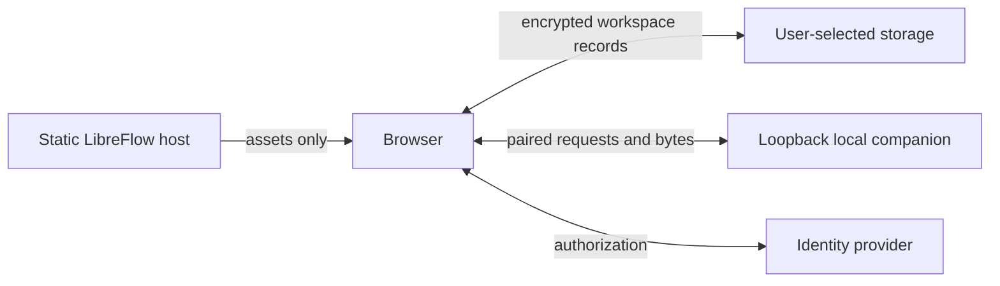

# Architecture and implementation decisions

Baseline: origin/main 27ceb593339ef444d6d85b5240d350ff13a7db5f. The remote was fetched and main fast-forwarded before branching. Local mode remains Express + JSON + files + Python.

## Existing dependency map

| Component | Existing dependencies / migration boundary |
| --- | --- |
| server.js | Express sessions, credentialed permissive CORS, static protected directories, job and webhook recovery; creates runtime directories at import/startup. Must never run on the static web host. |
| public/js/api.js | Cookie-authenticated /api REST calls. Other page scripts also fetch routes and construct /uploads URLs directly; changing this wrapper alone cannot make those pages stateless. |
| routes/auth.js | data/users.json, bcrypt, Express session user IDs; collaboration identity belongs only to self-hosted mode. |
| routes/images.js | Multer filesystem uploads, Sharp decoding/conversion, ZIP extraction, JSON image and batch indexes, user membership checks. |
| routes/models.js | Filesystem model/YAML paths, JSON model index, /infer and /segment proxy requests to Python. |
| routes/annotations.js | Per-image data and revision stores, project permissions, server-side exports and review updates. |
| routes/dataset-lifecycle.js | datasets/versions/uploads directories, ZIP imports/exports, immutable version manifests and API-key/session guards. |
| routes/automation.js | Server jobs, API keys, connectors, webhook delivery and filesystem ingestion. Unavailable on static host. |
| lib/connectors.js, lib/s3-client.js | Server-owned credentials encrypted by secret-box; AWS SDK server-side calls. Preserve local mode; never reuse host-held credentials for web mode. |
| lib/secret-box.js | AES-GCM but session-key/development-key fallback and plaintext legacy records; production needs dedicated key and rotation metadata. |
| lib/ingestion.js | Fetch, DNS/SSRF checks, redirect and port restrictions, bytes imported into uploads. |
| lib/inference-client.js | Validates real filesystem paths, model/image authorization, 180-second timeout; server proxy only, not a web bridge. |
| lib/json-store.js | Atomic-ish JSON writes, LIBREFLOW_DATA_DIR override; synchronous server disk collections. |
| lib/data-store.js | Alternate disk helper with runtime directory overrides and non-atomic writes. |
| lib/dataset-lifecycle.js | Server hash/content addressing and snapshot generation; portable semantic reference for browser workspace. |
| py_scripts/infer_server.py | FastAPI, arbitrary internal paths, Ultralytics YOLO/SAM model cache; trusted local API, unsuitable for browser exposure as-is. |
| Docker | Express and Python with bind mounts, Python 0.0.0.0 in container; separate static image required. |
| Existing tests | 52 Node tests covering auth boundaries, reviews, dataset versions, CLI, automation and annotation geometry. |

## Web boundary

Use a separately built static entry point; reuse the existing canvas/geometry code and provider-neutral domain contract, but never include scripts with server REST persistence in the static artifact. Keep a strict browser transport allowlist, in-memory OAuth tokens, encrypted workspace records, immutable snapshots, revision-aware mutations, and encrypted browser recovery. User-controlled providers are the source of truth. Provider-account sharing is distinct from Express collaborator accounts.

Do not expose arbitrary file paths or load untrusted pickle models in the companion control process. Do not silently emulate atomic writes for providers lacking conditional updates. Live-provider OAuth requires deployment-specific registered public client IDs and redirect URLs. Never ask for provider secrets in chat.
