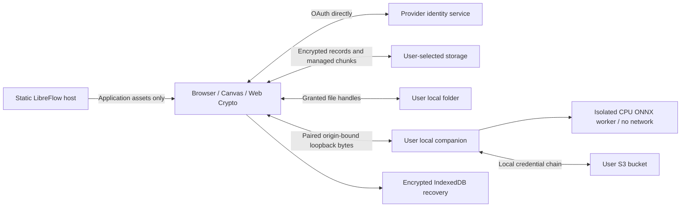

# Deploy and use the static workspace

This is a production-oriented implementation with verified local privacy boundaries. It is not yet a production-certified release: live OAuth accounts, other browsers, large datasets and independent cryptographic review remain unverified. See [security review](security-review.md) and [implementation report](implementation-report.md).

## Two runtimes

Self-hosted mode retains Express, local JSON/assets, accounts, collaborators, automation, dataset import/export and trusted local YOLO/SAM inference. Follow the existing setup guide and the new [production security configuration](self-hosted-security.md). Production refuses arbitrary PyTorch checkpoint uploads/inference; do not expose the legacy Python service publicly.

Web mode serves only `dist/web`. It reuses the existing Canvas geometry implementation with a provider-neutral API and encrypted workspace records. There is no central account database, Express session or host inference proxy. Server collaboration/automation are capability gated. Provider sharing controls who can access ciphertext; recipients also need the passphrase. Concurrent edits are preserved but live collaboration is not implemented.



The host can observe normal asset-request metadata. Providers observe object names, counts, sizes and timing; content-addressed chunk names reveal equality. Linked source images remain plaintext in their original provider location. Managed assets and workspace metadata are encrypted. The browser and code served by the host are trusted with decrypted data; a compromised deployment can defeat client encryption. No analytics are included.

## Build and host

```sh
npm ci
npm test
npm run check:web
npm run build:web
```

Deploy **only** `dist/web`, with HTTPS and the security headers in its `_headers`. Generic hosts do not all interpret `_headers`; configure equivalent headers explicitly. Serve `.mjs` as JavaScript. Do not deploy repository data, uploads, models, datasets, versions or Express alongside this artifact. The supplied Nginx configuration blocks those endpoints and mutations and disables access logs.

```sh
docker build -f Dockerfile.web -t libreflow-web:local .
docker run --rm --read-only --cap-drop=ALL --security-opt=no-new-privileges \
  --tmpfs /tmp --tmpfs /var/cache/nginx:uid=101,gid=101 \
  -p 127.0.0.1:8080:8080 libreflow-web:local
```

Terminate public HTTPS at your own proxy/static platform. Its policies must preserve CSP, no-referrer and no-sniff headers. The service worker caches an explicit build-generated list of static assets only; it never caches provider requests, URLs with queries, companion calls or user payloads. PWA installation/offline asset availability depend on browser support and a previously completed HTTPS visit.

## Configure providers

Edit the public application identifiers in `public/web/config.mjs`, then rebuild. These are public client IDs, never client secrets. Register the exact deployed HTTPS origin/callback with each provider. No credentials should be entered in deployment configuration.

- **Google Drive:** enable Drive API and configure a Web OAuth client and consent screen for `drive.file`; add the authorized JavaScript origin. Authorization uses Google Identity Services. Create a dedicated folder from the UI or select an app-authorized existing folder. Configure Google Picker API, the public Cloud project number and a referrer/API-restricted Picker API key to choose existing folders/images through the official picker. Google limits `drive.file` access to files created/opened by this app; manually entering an ID does not grant access. My Drive is the initial target; Shared Drives and the Picker SDK under production CSP need live verification.
- **OneDrive:** register a Microsoft SPA callback; use delegated `Files.ReadWrite`, with the appropriate account audience. Code + PKCE is exchanged directly with Microsoft; no refresh token is persisted. Personal accounts are the default tenant; organizational deployments require appropriate registration and tenant configuration.
- **Dropbox:** register a public client/PKCE redirect and file-content/file-metadata permissions needed by the adapter. Choose App Folder or Full Dropbox access deliberately. Enter/list folders in the namespace granted by that app.
- **S3-compatible:** first pair the local companion, then choose S3. Configure a dedicated bucket/prefix and credentials only on your machine, as described in [S3 setup](s3.md). Endpoints must honor conditional writes. IDs are process-local; managed chunks resolve after reconnect, but linked S3 references require re-linking after a companion restart.
- **Local folder:** Chromium browsers can use File System Access after a user gesture. Choose a dedicated folder; handles stay in memory and must be granted again after reload. Immutable writes avoid unreliable filesystem overwrite checks.
- **Portable browser workspace:** works without directory APIs using conventional image/model/backup file inputs. Provider files are temporary memory; export an encrypted backup before closing. Encrypted pending edits/drafts survive separately in IndexedDB, but imported/synced assets require the original backup after reload.

Use Authorize storage, list/create/select a dedicated folder, then Create workspace with a passphrase of at least 12 characters. Open existing workspaces using the same storage and passphrase. Tokens stay in memory; after expiry/revocation reauthorize and retry. Redirect-based authorization may require reopening the folder/passphrase; encrypted edits remain recoverable. Disconnect clears tokens/keys from the active page but retains encrypted recovery data. To erase recovery data, clear this site's browser storage.

## Work, backup and recover

Create a project, add images, choose a label/tool and save annotations. The Canvas supports existing geometry and undo/redo; every save appends an immutable revision. Review notes and status, dataset snapshots and UI session selection are encrypted records. Restore creates a new revision; old history remains. Snapshot versions are metadata manifests referencing immutable assets and annotations, not separate training-format exports.

The status displays pending writes, last successful sync and offline/conflict state. Offline mode queues encrypted records. Unsaved Canvas edits are encrypted as recovery drafts. Reopen/unlock the original workspace to recover them; reselect interrupted files to reuse verified chunks. Offline access to already-synced assets is limited: the recovery layer does not cache the entire remote dataset. Retry fetches remote events and sends pending writes. Deleted/modified immutable records or duplicate identities stop sync; preserve a backup before repairing provider files. Annotation forks offer explicit revision selection while keeping both historical branches. Other record conflicts fail closed and currently require API-level resolution rather than a general UI merge editor.

Export encrypted backups regularly. Portable import requires an empty destination, the passphrase and supported schema, and validates records/assets. [Workspace format](workspace-format.md) documents encryption, hashes and portability. [Local migration](migration.md) preserves annotations/reviews/versions without exporting credentials. Losing your passphrase or all backup copies makes recovery impossible; there is no LibreFlow recovery service.

## Inference and browser compatibility

Install/pair the [local companion](companion.md) on the user's computer and approve this site's exact HTTPS origin. Upload/select an ONNX model and run inference; bytes go only to loopback. Content-hash caching avoids repeated model uploads. YOLOv8/v11 detection output is supported, with CPU runtime. GPU and browser WebGPU/WASM inference are not implemented; browser ONNX was investigated but would add a large native/runtime dependency and another parser/security surface. SAM/PyTorch and generic unsupported output are explicitly unavailable in web mode. Browser cancellation stops transfer/waiting; a worker already started still has a hard timeout.

Chromium was tested with real CSP and HTTPS-to-loopback pairing. Firefox/Safari/mobile, local-network-access prompts/policies and live OAuth redirects require release verification. Secure-context Web Crypto and IndexedDB are required. If loopback access is denied by browser policy, manual annotation remains usable; inference/S3 require enabling the browser's local-network permission or using a compatible browser.

## Scale limits

Managed assets are streamed in 4 MiB encrypted chunks and duplicate chunks are reused. The UI bounds individual image/model files at 32 MiB; provider/object reads are similarly bounded. OneDrive/Dropbox support upload sessions; Drive uses multipart creates, with workspace-level chunk retry. Transfers are sequential, cancellable between requests and report progress. No full multi-gigabyte dataset is loaded for normal annotation; one selected image is decoded at a time. Thumbnails and automatic network backoff are not implemented; retry is explicit. Metadata sync scans immutable events, and portable export buffers the encrypted backup. Import/migration are capped at 128 MiB. This release must not be advertised as supporting million-record workspaces or multi-gigabyte portable exports.
